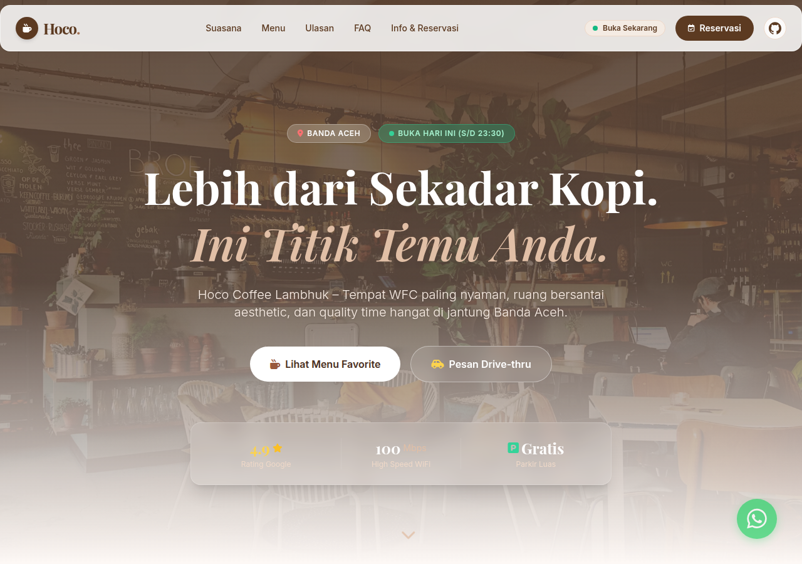
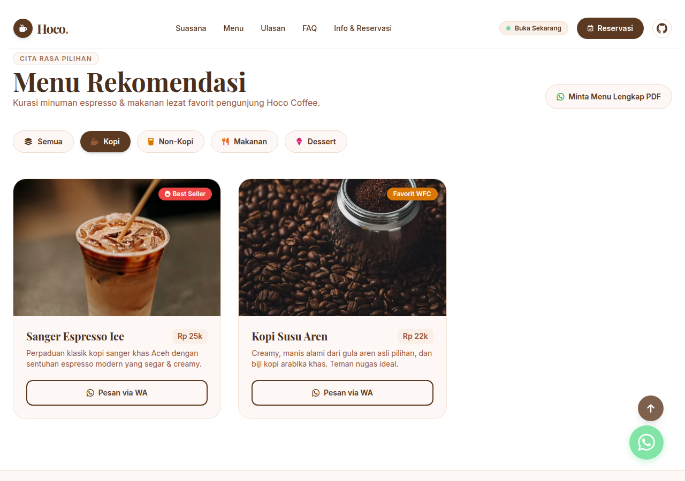
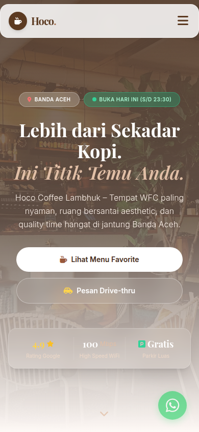

# Hoco Coffee — Landing Page

Landing page satu halaman untuk **Hoco Coffee Lambhuk, Banda Aceh** — kafe WFC (work from cafe), nongkrong, dan drive-thru. Satu file `index.html`, tanpa build step, tanpa backend.

🌐 **Live:** https://hococafe.pages.dev
📦 **Repo:** https://github.com/dezzorigin/hococafe-landing-page

## Screenshot





🎬 **Video demo:** [docs/demo.mp4](docs/demo.mp4) — 10 detik, tanpa suara (direkam headless; dinyatakan jujur).

## Fitur

- **Hero** — foto kafe, judul, CTA ke menu & drive-thru, bar statistik (rating, WiFi, parkir), indikator status buka/tutup.
- **Status buka/tutup live** — dihitung di browser dari jam operasional (Senin–Kamis 08:00–23:30, Jumat 14:00–23:30, Sabtu–Minggu 07:00–23:30) dalam zona waktu Asia/Jakarta, benar di zona waktu pengunjung mana pun.
- **Suasana (bento grid)** — vibe, fasilitas WFC, parkir, layanan.
- **Menu + filter kategori** — Kopi / Non-Kopi / Makanan / Dessert; 6 menu andalan, masing-masing dengan tombol pesan via WhatsApp.
- **Ulasan** — 3 testimoni pengunjung.
- **FAQ interaktif** — accordion (WiFi, reservasi VIP, drive-thru, pembayaran).
- **Info & reservasi** — jam operasional, pembayaran (QRIS, kartu, NFC), tombol reservasi WhatsApp.
- **Lainnya** — menu mobile, tombol WhatsApp mengambang, tombol kembali ke atas, animasi reveal saat scroll.

## Cara jalan

Tidak ada instalasi. Buka `index.html` di browser, atau jalankan server statis:

```bash
# Python
python3 -m http.server 8000

# Node
npx serve .
```

Lalu buka `http://localhost:8000`.

## Tech stack

| Lapisan | Teknologi |
|---|---|
| Markup | HTML5, satu file `index.html` |
| Styling | Tailwind CSS (Play CDN) + CSS kustom |
| Font | Inter + Playfair Display (Google Fonts) |
| Ikon | Font Awesome 6 |
| Foto | Unsplash (stok) |
| Interaksi | JavaScript vanilla (tanpa framework) |
| Deploy | Cloudflare Pages (direct upload) |

## Struktur proyek

```
.
├── index.html                  # seluruh landing page
├── .github/workflows/ci.yml    # html-validate + link-check + smoke
├── scripts/smoke.mjs           # pemeriksaan struktur & konsistensi
├── docs/
│   ├── architecture.md
│   ├── diagram.svg
│   └── screenshots/            # screenshot tampilan asli
├── README.md
├── PRD.md
├── CHANGELOG.md
└── LICENSE                     # MIT
```

## CI

Tiga job di GitHub Actions (tanpa build step — memang tidak ada yang di-build):

1. **validate** — `html-validate` atas `index.html` (0 error).
2. **links** — `markdown-link-check` atas README/PRD/CHANGELOG/docs.
3. **smoke** — `node scripts/smoke.mjs`: section wajib ada, link GitHub ada,
   semua link `wa.me` memakai satu nomor yang sama, kategori kartu menu
   punya tombol filternya, status memakai `Intl.DateTimeFormat` Asia/Jakarta.

Jalankan smoke lokal: `node scripts/smoke.mjs`.

## Batasan — dibaca jujur

- **Tidak ada pemesanan online.** Semua tombol "Pesan via WA" membuka chat
  WhatsApp kafe (nomor 0812-6406-5722) — tidak ada keranjang, checkout, atau backend.
- **Rating 4.9, WiFi 100 Mbps, dan testimoni** adalah klaim sebagaimana tertulis
  di halaman (dari pemilik/kafe) — **tidak terverifikasi independen** dari repo ini.
- **Foto-foto berasal dari Unsplash** (foto stok), bukan foto asli interior/menu kafe.
- **Harga menu** (Rp 22k–30k) sesuai yang tertulis di halaman; bisa berubah —
  sumber kebenarannya adalah kafe, bukan repo ini.
- **Jam operasional & status buka/tutup** mengikuti tabel jam di halaman;
  hari libur khusus tidak ditangani.

## Lisensi

MIT — lihat [LICENSE](./LICENSE).
